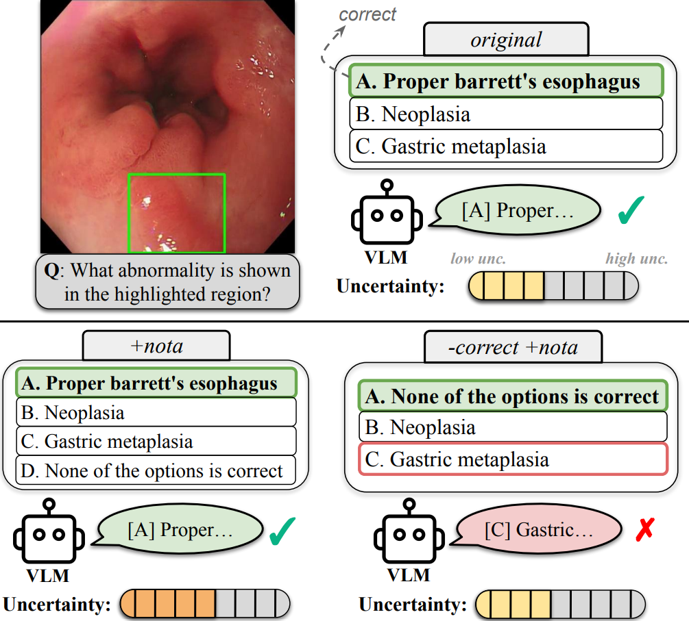

# Uncertainty Is Not a Safety Net for Clinical VQA, but Can It Anticipate Model Failure?

This repository contains the code, data processing scripts, and experiments accompanying the paper:

**Uncertainty Is Not a Safety Net for Clinical VQA, but Can It Anticipate Model Failure?**  
Arnisa Fazla*, Alberto Testoni∗, Ameen Abu-Hanna, Barbara Plank, Iacer Calixto     
[arXiv:2606.16583](https://arxiv.org/abs/2606.16583) - Accepted to EMNLP 2026 (Findings).

<!-- <p align="center">  </p>

<p align="center"> <em>Overview of our evaluation of uncertainty estimation in clinical VQA. While uncertainty does not reliably track model correctness under stress, it can anticipate predictions that are vulnerable to model failure.</em> </p> -->

---
## Repository Status

⚠️ **Work in Progress**  
This repository is being updated gradually. Some scripts and documentation may be incomplete or subject to change. Please check back regularly for updates.

---

## Overview

Reliable uncertainty estimation (UE) is critical for the safe deployment of clinical vision-language models (VLMs), where uncertain predictions should be identified and escalated to a clinician.
In this work, we systematically study whether current UE methods provide a reliable signal of prediction trustworthiness in clinical visual question answering (VQA). Our contributions are:

1. **Benchmarking uncertainty estimation.**
We systematically benchmark 8 uncertainty estimation methods across 12 clinical VLMs on clinical VQA, evaluating how reliably uncertainty identifies correct and incorrect predictions.
2. **Characterizing the dependence of UE quality on model accuracy.**
We find that UE quality is not an intrinsic property of the uncertainty estimation method. Instead, it closely tracks model accuracy, degrading precisely where model performance is weakest, and where reliable uncertainty estimates are most needed.
3. **Stress-testing uncertainty with NOTA perturbations.**
We introduce NOTA (None-of-the-Above) perturbations, which hide the correct answer among the multiple-choice options. Under this stress test, model accuracy collapses while uncertainty changes only marginally, revealing systematic miscalibration and a failure of current UE methods to reflect prediction fragility.
4. **Using uncertainty as a diagnostic signal of model fragility.**
Despite this limitation, we find that uncertainty on the unperturbed input reliably anticipates which predictions will collapse under NOTA perturbations. This suggests that UE contains diagnostic information about model fragility, motivating perturbation-based evaluation as a promising direction toward safer clinical deployment.

---

## Instructions

### Step 1. Load the variables (including the hyperparameters) in the beginning of each terminal session:

            source .env

### Step 2: Download the test split of
   [GMAI-MMBench](https://uni-medical.github.io/GMAI-MMBench.github.io/)
   ([Chen et al., 2024](https://arxiv.org/abs/2408.03361)).

            mkdir -p "$DATA_DIR" "outputs/$DATASET"

            python code/scripts/download_gmai_mm_bench.py \
            -o "$DATA_DIR/"

> Save the images and the text input separately for performance improvement.

            python -m code.scripts.save_images_separately \
                  --filename GMAI_mm_bench_VAL_images_removed.tsv \
                  --input-tsv "$DATA_DIR/GMAI_mm_bench_VAL.tsv" \
                  --output-dir "$DATA_DIR/"

> Optional: Merge the imaging modalities with "MRI" in their names under the "MRI" imaging modality

            python code/scripts/merge_modalities.py \
                  --input-tsv "$DATA_DIR/GMAI_mm_bench_VAL_images_removed.tsv" \
                  --output-dir "$DATA_DIR/GMAI_mm_bench_VAL_images_removed_MRI_merged.tsv"

> Filter the dataset according to modalities and number of samples (N) per each modality. Also shuffle the answer options K times randomly (set K to 1 if you don't want to shuffle). Save the resulting TSV file in corresponding folder under `./outputs`.

            FINAL_OUTPUT_DIR="outputs/$DATASET/N_${N}-K_${K}-M_${#MODALITIES[@]}"

            python -m code.scripts.filter_dataset \
                  --input-tsv "$DATA_DIR/GMAI_mm_bench_VAL_images_removed_MRI_merged.tsv" \
                  --n-per-modality "$N" \
                  --k-augment "$K" \
                  --modalities "${MODALITIES[@]}" \
                  --output-dir "$FINAL_OUTPUT_DIR" 

### Step 3. Download the models (select which models to download by editing `code/scripts/download_models.py`) and run inference:

            python code/scripts/download_models.py \
                  -o "models/"

            INPUT_FOLDER="outputs/$DATASET/N_${N}-K_${K}-M_${#MODALITIES[@]}"

> Select the model for inference, and hyperparameters such as temperature, top_p. The code will save the model responses, logprobabilities etc. in the corresponding folder.

            MODEL_NAME="medgemma-4b-it"
            OUTPUT_DIR="$INPUT_FOLDER/${MODEL_NAME}-temp_${TEMPERATURE}-topp_${TOP_P}-S_${S}"

            mkdir -p "outputs"

            python -m code.scripts.run_inference \
                  --input-tsv "${INPUT_FOLDER}/filtered_data.tsv" \
                  --images-dir "$DATA_DIR/images" \
                  --model-mapping-path "code/utils/model_mapping.json" \
                  --output-dir "$OUTPUT_DIR" \
                  --model_name "$MODEL_NAME" \
                  --model_path "$MODEL_PATH" \
                  --prompt_template "$PROMPT_TEMPLATE" \
                  --batch_size "$BATCH_SIZE" \
                  --sample_s "$S" \
                  --temperature "$TEMPERATURE" \
                  --top_p "$TOP_P"

> Extract the answer options from model responses (using regex and an LLM) and save them in a file called "extracted.tsv". [PATH_TO_MODEL_OUTPUTS_TSV] can be for example `outputs/GMAI-MMBench/N_210-K_4-M_8/llava_1.6_7b-default-temp_0.6-topp_0.9-S_10/inference_20_October_2025.tsv`. Since `run_inference.py` saves teh model outputs with the date in teh filename, enter the full path to the output TSV file manually. Make sure the model name matches across all the argparse inputs, including the `--output-dir`

            python -m code.scripts.extract_save_model_answers \
                  --input-tsv [PATH_TO_MODEL_OUTPUTS_TSV] \
                  --output-dir $OUTPUT_DIR \
                  --model-mapping-path "code/utils/model_mapping.json"
                  --model_name [MODEL_NAME]


> Embed the outputs for all the existing model responses and save the embeddings. Note that the `embed_outputs.py` script will create a folder `outputs/GMAI-MMBench/N_210-K_4-M_8/embeddings` (if we assume the default hyperparameters, N=210, K=4 and 8 modalities). This folder contains embeddings per each model, and named with the model names. Then you need to copy paste each file in the corresponding model folders (for example `outputs/GMAI-MMBench/N_210-K_4-M_8/llava_1.6_7b-default-temp_0.6-topp_0.9-S_10`).

            python -m code.scripts.embed_outputs \
                  --input-folder "${OUTPUT_FOLDER}" 
            
> Refer to the `code/scripts/gpt_save_jsons.py` to format the input samples in JSON format OpenAI API expects, and `code/notebooks/gpt_experiments.ipynb` for running the GPT experiments through OpenAI API and saving the results.

### Step 4. Inference with modified inputs

> `code/notebooks/modifications.ipynb`: For modifying the inputs and saving the modified TSV files. This code will create new directories (for example: `outputs/GMAI-MMBench/N_210-K_4-M_8-plus_none/` and `outputs/GMAI-MMBench/N_210-K_4-M_8-correct_to_none/`). Follow step 3 for running inference on the modified inputs, changing the input and output folder paths.

### Step 5. Analyses

> Save the sample IDs for the samples the model answer flipped from correct to wrong, and for samples the model answer stayed the same, for two types of input modifications.

            python -m scripts.save_nota_answer_flips \
                  --original-folder "${OUTPUT_DIR}"
                  --plus-nota-folder "$outputs/$DATASET/N_${N}-K_${K}-M_${#MODALITIES[@]}-plus_none/${MODEL_NAME}-temp_${TEMPERATURE}-topp_${TOP_P}-S_${S}"
                  -minus-correct-plus-nota-folder "$outputs/$DATASET/N_${N}-K_${K}-M_${#MODALITIES[@]}-correct_to_none/${MODEL_NAME}-temp_${TEMPERATURE}-topp_${TOP_P}-S_${S}"

> Refer to `code/notebooks/process_outputs.ipynb` for computing the final results in the paper (Section 4.1, 4.2, 5.1) and saving them in pandas dataframes, in the folder `outputs/GMAI-MMBench/plots`. `code/notebooks/none_exps.ipynb` contains the code for computing and printing out the results in Section 5.2 in latex.

> After running the two notebooks; `code/plotting/` folder includes python scripts to generate final versions of the tables and figures in tha paper: `4_1_main_table.py`, `4_2_plot_histogram_per.py` `5_1_deltas_table.py`.


## Citation

If you use this code or data in your research, please cite:

```bibtex
@misc{fazla2026uncertaintysafetynetclinical,
      title={Uncertainty Is Not a Safety Net for Clinical VQA, but Can It Anticipate Model Failure?}, 
      author={Arnisa Fazla and Alberto Testoni and Ameen Abu-Hanna and Barbara Plank and Iacer Calixto},
      year={2026},
      eprint={2606.16583},
      archivePrefix={arXiv},
      primaryClass={cs.CL},
      url={https://arxiv.org/abs/2606.16583}, 
}
```